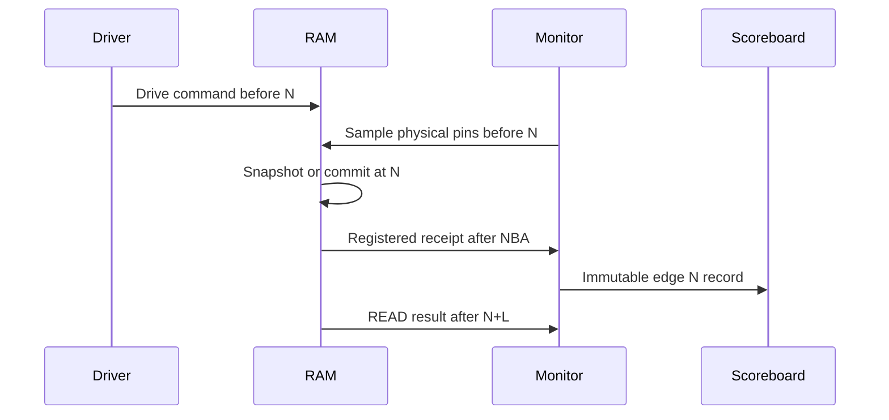

# Shared BRAM RAM edge contract (TASK 2)

**Status: IMPLEMENTED as a UVM interpretation; pin/peer freeze BLOCKED.**
Source: supplied L2 v1.2 §2, §3.1, §3.4–3.5. A normal issue has no READY:
every rising edge with a valid selected physical enable is one issue.

| Time relative to issue N | READ | WRITE | INIT |
| --- | --- | --- | --- |
| Falling edge before N | Driver places command/address/full ticket; keeps stable through N | Driver places data and byte mask as well | Controller presents selected sweep index and physical INIT WE |
| Immediately before rising N (`pre_cb`, input `#1step`) | `ram_rd_en_i`, address, ticket and actual `physical_rd_en_o` sampled | `ram_wr_en_i`, WDATA, WSTRB, ticket and actual `physical_wr_en_o[3:0]` sampled | Actual `init_write_en_o` and its `init_addr_o` sampled together |
| Rising N | Array READ snapshot and ticket captured | Selected bytes commit at this edge | Full-word zero write commits at sampled index |
| After NBA at N (`#1step` later) | No result for this new READ yet | Registered `ram_wr_commit_valid_o`/ticket visible; peer samples at N+1 | `init_commit_o` records this edge's INIT write; DONE remains low on final commit edge |
| Immediately before N+1 | Previous registered WRITE receipt remains visible unless reset | New back-to-back issue can coexist with prior receipt | Next INIT address may already be selected |
| After NBA at N+1 | READ result/data/ticket for `READ_LATENCY=1` | New WRITE receipt if another physical WE occurred at N+1 | DONE may assert only after final commit and quiescence |
| After NBA at N+2 | READ result/data/ticket for `READ_LATENCY=2` | Independent of prior normal ticket | — |

An edge N+1 may both return the READ issued at N (latency 1) and issue a new
READ/WRITE. For latency 2, a WRITE to the same address at N+1 cannot alter
the READ snapshot returned after N+2. Registered receipts are compared after
NBA; physical enables and INIT address are compared at the actual issue edge.

## Pin-freeze questions

1. Confirm `physical_rd_en_o`, `physical_wr_en_o` and `init_write_en_o` are
   the **actual pre-edge primitive enables** at the edge that commits, rather
   than registered history pulses. The monitor records both pre-edge and
   post-edge versions, but the checker treats pre-edge values as physical
   issues. If the RTL provides only registered taps, add/freeze actual issue
   taps instead of shifting the expected latency to match implementation.
2. Confirm `init_commit_o` is registered visible after the *same* index's
   physical write edge. `init_addr_o` can advance after NBA, which is why the
   monitor records the pre-edge address.
3. The specification requests zero full-word INIT writes but does not freeze
   physical INIT WDATA/mask output pins. The checker proves the 16,384 INIT
   enables/addresses and a full-array zero readback; direct observation of
   primitive INIT data/byte enables requires a pin or bind contract.
4. §2 names `ram_issue_ticket_i`, while §3.4 says `ram_service_ticket_i`.
   Freeze the actual name and parameter width before DUT elaboration.
5. The phrase “after exactly READ_LATENCY synchronous registered periods” is
   interpreted as a result after NBA of N+L, where N is the snapshot edge.
   Confirm this edge table in the normative pin freeze; a different intended
   counting convention needs a specification revision, not a checker waiver.

The checker never substitutes a later RTL-observed timing for the N/N+L
contract. Any incompatible pin implementation is a reported mismatch or a
specification-review gate.
